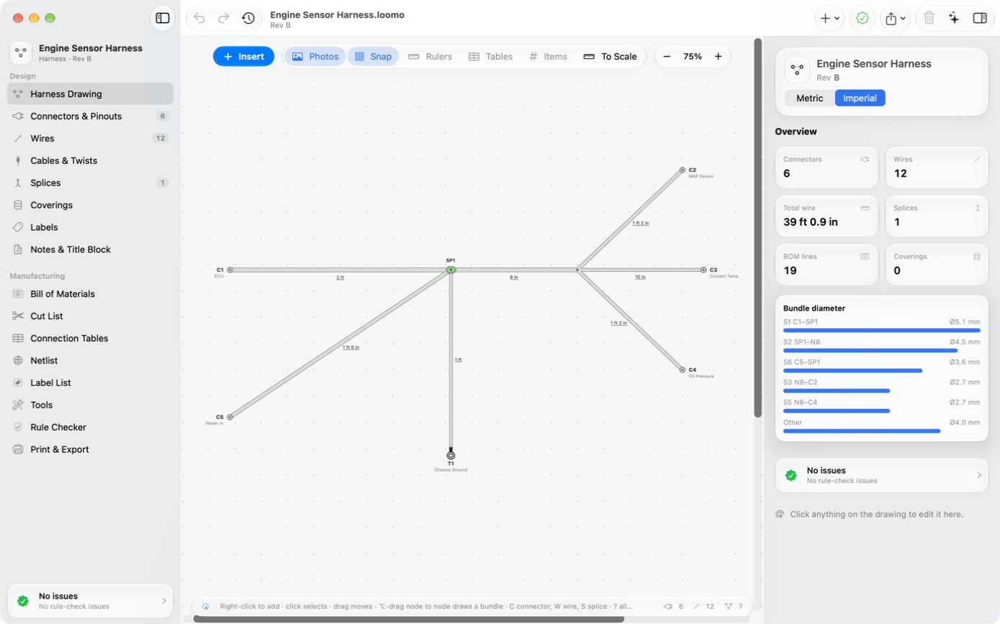
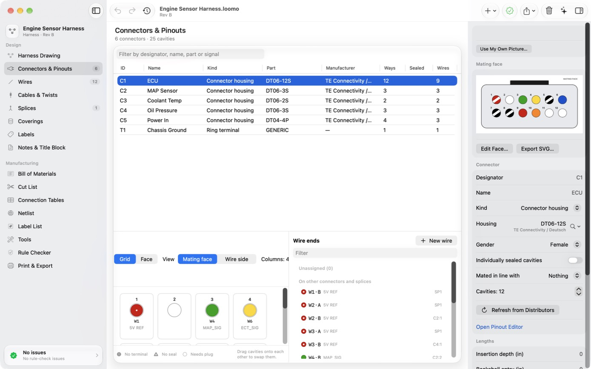
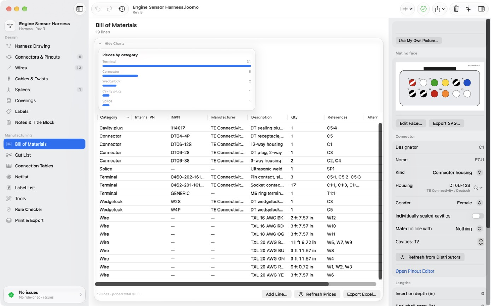
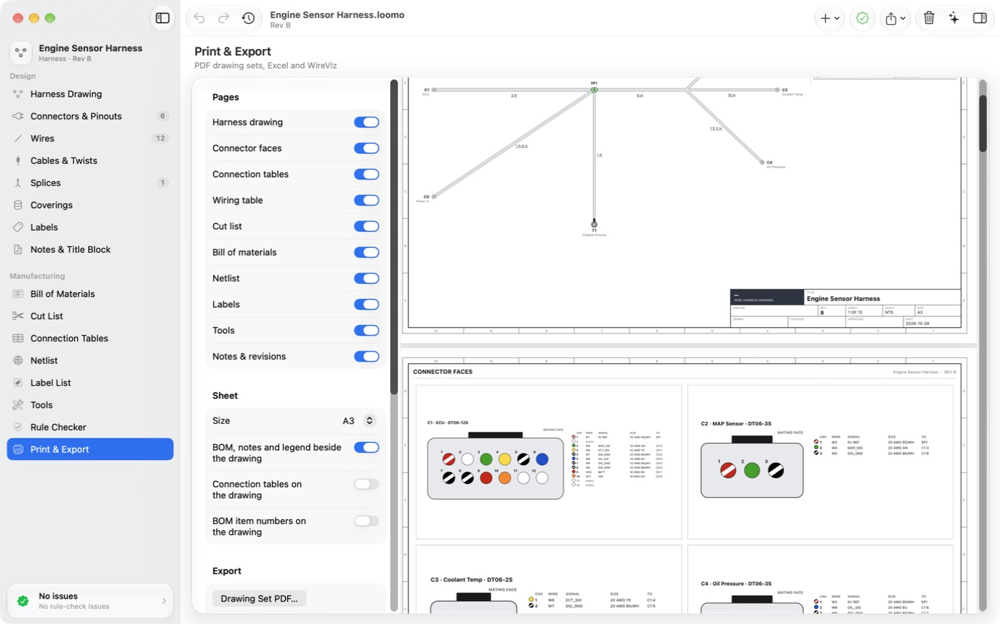

<div align="center">


# Loomo

**A free, open source Mac app for designing wire harnesses.**

You draw the harness, and Loomo figures out the wire lengths, parts list, cut list and drawings for you.

[](#install)
[](https://swift.org)
[](LICENSE)

[Install](#install) · [Features](#features) · [Quick start](#quick-start) · [Guide](docs/GUIDE.md) · [Contributing](CONTRIBUTING.md)

<br>



</div>

## What is this?

A wire harness is the bundle of wires, connectors and terminals that ties the electrical parts of a car, a
machine or a robot together. Designing one usually means juggling a CAD drawing, a pinout spreadsheet and a
parts list, and keeping all three in sync by hand.

Loomo puts that in one place. You place your connectors, run wires between pins, and lay out how the bundles
branch. From there it works out how long every wire needs to be, checks your design for mistakes (wrong wire
size for a terminal, a missing seal, two wires in one cavity), and makes everything you need to build it: a
bill of materials, a cut list, connection tables, labels, a printable drawing set and a 1:1 formboard.

It's built for anyone making harnesses, whether that's a one-off for a project car or something going to a
shop for production.

## Screenshots

<table>
  <tr>
    <td></td>
    <td></td>
    <td></td>
  </tr>
  <tr>
    <td align="center"><b>Pinouts</b><br>Cavity grids and mating faces, colored by wire</td>
    <td align="center"><b>Bill of materials</b><br>Every part, contact and wire length</td>
    <td align="center"><b>Drawing set</b><br>Print-ready PDF sheets</td>
  </tr>
</table>

## Features

- **Draw the layout.** Connectors, splices, breakouts and bundles. Wire lengths come straight from the drawing.
- **Pinouts and wiring.** Cavity grids for every connector, plus wires, cables, twisted pairs, seals, plugs
  and coverings.
- **Catches mistakes early.** Rule checks flag wire-size, terminal, seal and routing problems as you go.
- **Everything for the build.** BOM, cut list, connection tables, labels, a PDF drawing set, a 1:1 formboard
  and an Excel workbook.
- **Real parts.** Search Mouser, Digi-Key, TrustedParts, OEMsecrets and Octopart for parts, photos and
  prices. You use your own free API keys, so nothing goes through a server of mine.
- **Bigger projects.** Put devices and several harnesses in one system project and trace a signal across all
  of them.
- **Works with Claude.** Claude, or any app that speaks MCP, can edit the harness you have open while you
  watch. Every change it makes is one undo away.
- **iCloud.** Your projects on all your Macs, and a parts library you can share with your team.
- **Command line.** The `crimp` tool can do anything the app can, so you can script it.
- **WireViz.** Open your existing WireViz files, or export to them (more below).
- **Stays up to date.** Loomo checks for new versions and installs them for you.

## Install

1. Download the latest **Loomo.dmg** from [Releases](https://github.com/Anrew3/Loomo/releases).
2. Open it and drag **Loomo** to **Applications**.
3. Open Loomo. It's signed and notarized by Apple, so you won't get any scary warnings.

Requires macOS 26 on Apple silicon or Intel.

## Quick start

The first time you open Loomo, a quick setup walks you through three things. They're all optional, and you
can skip any of them and come back later.

| Step | What it does |
|---|---|
| **Parts sources** | Paste free API keys from distributors such as [Mouser](https://www.mouser.com/api-search/) or [Digi-Key](https://developer.digikey.com/). Keys stay in your Mac's Keychain. |
| **iCloud** | New projects save to iCloud Drive and autosave. |
| **Claude** | One click connects Claude Desktop. Then ask it to "add a 4-way Deutsch connector and wire it to C1". |

After that, press **⌘N** to start a harness and **C** to drop in a connector. If you'd rather poke around a
finished design first, click **Try the Sample Harness** in the welcome window.

## Build from source

```bash
git clone https://github.com/Anrew3/Loomo.git
cd Loomo
open Loomo.xcworkspace   # Run the Loomo scheme; ⌘U runs the tests
```

No Apple Developer account needed. A clone builds and runs as is, with iCloud off. To turn on iCloud, copy
`Config/Local.xcconfig.example` to `Config/Local.xcconfig` and add your Team ID.

The engine builds and tests on its own: `cd Packages/CrimpKit && swift test`.

## Command line

```bash
crimp new bench.loomo
crimp add-connector bench.loomo --mpn DT06-2S --manufacturer "TE Connectivity" --cavities 2
crimp add-connector bench.loomo --mpn DT04-2P --manufacturer "TE Connectivity" --cavities 2
crimp add-wire bench.loomo --from C1:1 --to C2:1 --size 18awg --color red
crimp validate bench.loomo
crimp pdf bench.loomo --out bench.pdf
crimp import-wireviz serial.loomo --from serial.yml
```

`crimp` ships inside the app at `Loomo.app/Contents/MacOS/crimp`. The [guide](docs/GUIDE.md) covers every
command and the MCP tools.

## WireViz

[WireViz](https://github.com/wireviz/WireViz) is a popular open source Python tool where you describe a
harness in a YAML text file and it draws the wiring diagram for you. Loomo works with it both ways:

- **Bring WireViz files in.** File ▸ Import ▸ WireViz YAML as New Harness… turns a `.yml` file into a
  Loomo harness, with its connectors, pin labels, part numbers, wire gauges and colors. From the command line:
  `crimp import-wireviz harness.loomo --from harness.yml`.
- **Send harnesses out.** File ▸ Export ▸ WireViz YAML… writes a file WireViz can render, so you can keep using
  its diagrams in your docs:

  ```bash
  pip install wireviz
  wireviz harness.yml
  ```

So if you've already got harnesses written for WireViz, you don't have to start over. Open them in Loomo, lay
out the bundles, and get real wire lengths and build documents out of them.

## Documentation

- [Guide](docs/GUIDE.md): the app in detail, the CLI, Claude and MCP, iCloud, tests and project layout
- [Features](FEATURES.md): what's implemented
- [Design](DESIGN.md): architecture
- [Releasing](RELEASING.md): building the signed, notarized DMG

## Contributing

Found a bug or have an idea? Open an issue. Pull requests are welcome too; see
[CONTRIBUTING.md](CONTRIBUTING.md) to get started.

## License

[MIT](LICENSE)
